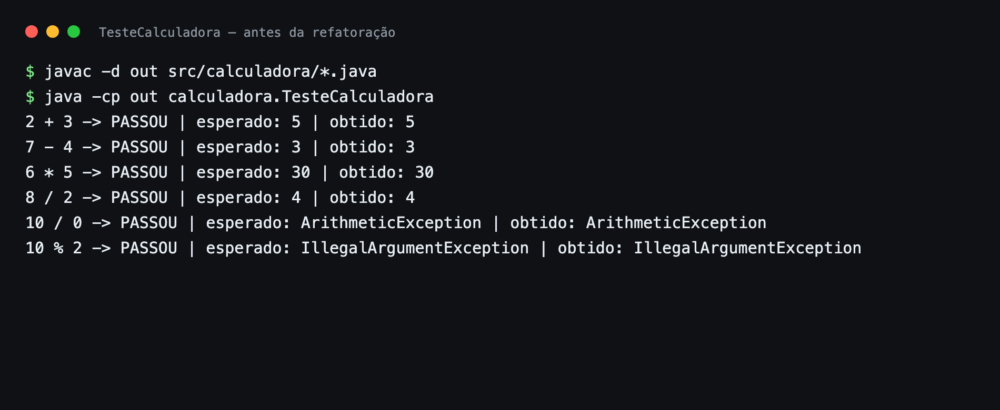
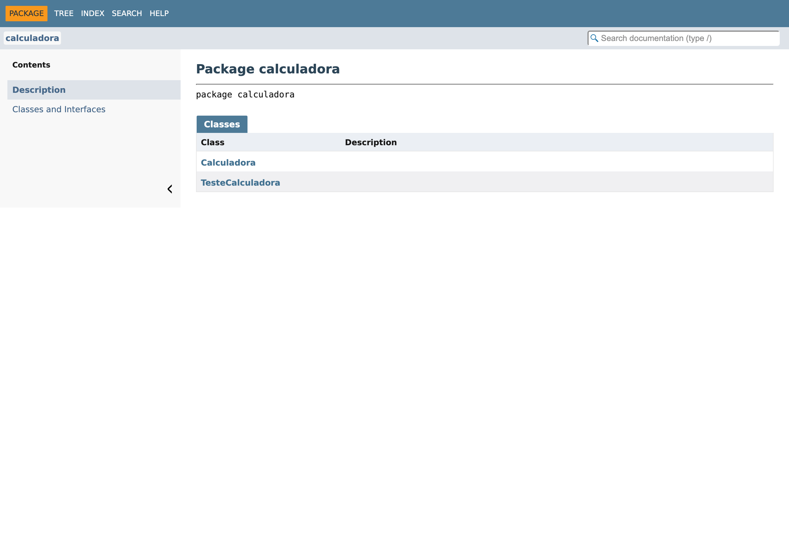

# Projeto Calculadora

## Descrição do projeto

Calculadora desenvolvida em Java para o módulo de cálculos matemáticos de uma
aplicação de controle de finanças pessoais. O projeto realiza as quatro
operações básicas (`+`, `-`, `*`, `/`), trata divisão por zero e operadores
inválidos, possui testes funcionais via `main` e documentação gerada com JavaDoc.

## Objetivo da atividade

Aplicar, na prática, conceitos de qualidade de software: testes funcionais,
tratamento de erros, refatoração, documentação técnica com JavaDoc e
versionamento de código com Git e GitHub.

## Tecnologias utilizadas

- **Java** (JDK 25)
- **javac** e **java** para compilação e execução
- **JavaDoc** para geração da documentação HTML
- **Git** e **GitHub** para versionamento e publicação

## Explicação das operações

A classe `Calculadora` expõe o método `calc(int a, int b, String op)`:

| Operador | Operação      | Exemplo   | Resultado |
|----------|---------------|-----------|-----------|
| `+`      | Soma          | `2 + 3`   | `5`       |
| `-`      | Subtração     | `7 - 4`   | `3`       |
| `*`      | Multiplicação | `6 * 5`   | `30`      |
| `/`      | Divisão       | `8 / 2`   | `4`       |

Tratamento de erros:

- **Divisão por zero** (`10 / 0`): lança `ArithmeticException` com a mensagem
  `Divisão por zero`, sem interromper o programa.
- **Operador inválido** (`10 % 2`): lança `IllegalArgumentException` com a
  mensagem `Operador inválido: %`.

## Como executar

```bash
javac -d out src/calculadora/*.java
java -cp out calculadora.TesteCalculadora
```

Para gerar o JavaDoc:

```bash
javadoc -d docs -sourcepath src -private -author -version calculadora
```

Depois, abra `docs/index.html` no navegador.

## Resultados dos testes

### Testes antes da refatoração



### Testes depois da refatoração


## Documentação JavaDoc



Documentação gerada em [`docs/index.html`](docs/index.html).

## Estrutura do projeto

```
projeto_calculadora
├── docs/                  # JavaDoc gerado (index.html)
├── prints/                # Imagens dos testes e da documentação
├── src/calculadora/
│   ├── Calculadora.java
│   └── TesteCalculadora.java
└── README.md
```

## Branches

- [main](https://github.com/gabrielmarques23/projeto_calculadora_ui_ux/tree/main):
  calculadora e testes, sem a refatoração.
- [Refatoracao](https://github.com/gabrielmarques23/projeto_calculadora_ui_ux/tree/Refatoracao):
  inclui a extração de métodos, a documentação JavaDoc e os testes executados
  após a refatoração.

## Repositório

https://github.com/gabrielmarques23/projeto_calculadora_ui_ux
